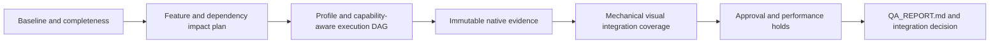

# Urban Fracture — permanent QA infrastructure audit

**Assignment 1 only · UF-AUDIT-028 · 2026-11-13 (America/Chicago)**

Audit work is complete. **Whole-game certification and stable integration remain Blocked.** No production code, artwork, existing test, QA policy, or existing report has been changed by this audit. No permanent analyzer, profile system, CI hook, or certification gate is implemented yet.

## 1. Baseline and recoverable checkpoint

| Item | Verified value |
|---|---|
| Audited code commit | `61264572c00ce9c138518f3e51ae75a122c3eccb` |
| Source branch at start | `fix/grounded-crop-surface-reuse` |
| Audit branch | `audit/permanent-qa-infrastructure` |
| Designated approved development baseline | `stable/combat-stabilization` at `f00cc9c9fdce8f2c70a875a2de6e380371c67720` |
| Recoverable tracked-code checkpoint | `checkpoint/before-permanent-qa-audit-028`, pointing to `6126457` |
| Approved mechanics through UF-COMBAT-018 | `db2e17b50472ca43757e90ac9bdf8bc7b0b48abb`, ancestor of audited code |
| Current fighter-source fingerprint | `24c551c639dc4b0d70e8bb2bfbbf7b8bef32348b127e49288eaaef722742a64a` |

The audit's final documentation commit is recorded in the delivery manifest; it does not change the audited game code. “Stable development baseline” is a branch role, not proof that this older commit has full-game/manual certification.

UF-COMBAT-018, UF-QA-020/022/023 and UF-RENDER-025/027 are retained by ancestry and source checks. Only `dist/index.html` and `dist/sprites.js` differ from the approved mechanics commit. Reversing the documented 025/027 render-only changes recovers its exact sprites bytes. All other gameplay source remains identical. All **258** stable-baseline suite entries and their manual gates/policy remain unchanged; the current catalog adds 15 entries. This is preservation evidence, not a fresh execution of every historical repair test.

Compared with stable, the audited development line has **1,641 changed paths**, predominantly added tools/evidence. The complete added/modified/renamed/deleted inventory is in `inventory.json`; only two production paths differ. Modified/replaced content is represented by Git's actual statuses rather than guessed from filenames. Directly affected systems are shared rendering/resource management and QA infrastructure; all grounded render consumers are indirect scope. Combat/AI/collision/controller changes are not hidden in that diff.

The checkpoint protects tracked files, not arbitrary untracked files or missing original sources. Original ZIP metadata was visible for Part01, but Python/.NET direct archive access failed in this execution context. No central-directory/CRC verification or restoration was completed; cause is unestablished. See `archive-access.txt`. The original export manifest is copied into the audit evidence so its expected hashes remain available. Do not overwrite approved repairs with a fresh old-source extraction.

## 2. Project completeness

The original manifest lists **9,258 files**. Current exact path/hash inspection finds:

| Original-manifest state | Count |
|---|---:|
| Exact original-byte match | 2,765 |
| Present but changed | 33 |
| Missing | **6,460** |

Missing content totals **1,486,953,612 bytes**, mainly authoring art, source archives, historical QA captures/reports, design and specification files. The earlier 6,486 figure is outdated: 26 additional manifest paths are now present. Presence does not itself mean those paths are approved originals; the per-file hash inventory distinguishes them.

All **1,675 original `dist/` paths are present**: 1,661 match original bytes, with 14 approved-source modifications. All **1,126 current raster images** match the supplied Build338 export by hash. This supports testing the current runtime. It does **not** establish complete authoring source, every required reference, all campaign behavior, or a complete game export.

Missing evidence has immediate consequences: four original background-derivative backups and six registered retirement backups are absent. Three user-specification files and the old QA report template are also missing. Whole-project completeness is Blocked; current-runtime work can continue with an explicit partial-checkout scope. Restore only required missing paths after review, verify their original manifest hashes, and retain all approved changed paths.

## 3. Reusable infrastructure already present

| Component | Reuse | Scope/limitations |
|---|---|---|
| `qa/system242/suites.json` | **273 suites**, 196 initial / 273 release; no duplicate IDs or missing declared command files | Suite catalog, not a feature/coverage registry; 38 entries lack `framework`; no entries declare the requested feature source/dependency/test/review metadata |
| `tools/qa242/run.cjs` | Serial execution, lock, timeouts, logs, generated-artifact preservation, start/end source checks | Only `initial`/`release`; hardcoded executables; exit2 unavailable becomes Failed; latest files overwrite prior run evidence; no change-impact selection |
| `tools/qa242/validators.cjs` | Aspect, scale, grounding, gait, numeric action phases, attachment and gate primitives; six tests pass | Numeric timing/exit checks do not establish physical recovery motion or artistic quality |
| `tools/qa242/runtime.cjs` | Seeded RNG/clock, **209** current simulation modules, prototype ownership/load hash | Good fixture foundation, not complete input/state replay or every feature certification |
| `tools/fighter-render/` | Pinned Canvas1.1.1/Playwright1.57.0, Chromium143; manifest/bootstrap, readiness, late owners, native captures | 179 render modules,73draw owners,1,041decoded requests in latest repair evidence; scoped samples, not every pose/character/level |
| Combat protection suites | Shared admission, hitstun, knockdown, deadlines, collision/height, Director and observer regression cases | Preserve all approved assertions and exceptions; representative success is not universal move coverage |
| Portable receipts/runtime adapters | Runtime behavior can run while missing historical receipts remain explicitly unavailable | **45 receipts unavailable** remains a strict release blocker; never invent source proof |
| Grapple/Forest/current family tools | Original9,434view checks; current48cases/480samples; lifecycle/ownership/damage/mirrored assertions | Shared301enrollment and sampled characters do not cover every boss or unique grapple |
| Developer tools | Practice278/282, Playback265/UI, Audit135, Plane304, AIObserver/Inspector288, Diagnostics307, precision lab | Actual runtime values and explicit N/A are useful; observational playback is not full reversible/input-state replay |
| Asset checker/comparator | Hash/dimension inventory, verified retirement/derivative policies, no automatic artistic approval; exact-geometry comparator | Current checker fails on host path identity and missing/stale evidence; approved screenshot registry is empty |
| Level/environment/input/save-area tests | Many existing route, mission, weather, controller, reserve/supplies/HQ/phone tests | No complete registered progression/save/canonical-pair matrix; simulated controllers do not certify hardware |
| Repair history/evidence | `COMBAT_REPAIR_LOG.md`, 148 top-level structured records inventoried across current `reports-*` folders | Different schemas/fingerprints/scopes; older reports remain historical, not automatically current certificates |

There are **565 files under `tests/`**, of which 227 are directly referenced by catalog commands. The other 338 include legacy suites, helpers and argument-dependent tools; **they are not 338 proven missing runnable tests**. A maintained entry/helper/legacy classification is needed. Examples of absent direct entries include `airport332`, City334, messages335, notifications336, Nova333, Slums337 and `broxton179`; some receive indirect coverage in scoped runners. Home338 has registered subsets. Filename matching alone cannot prove coverage.

Runtime enumeration finds **7 heroes**, 40 statistics entries, 32 non-hero/companion practice candidates, **25 available isolation adapters**, and **211 scene-picker entries**. Seven practice IDs lack isolation support: Dorian, Ethan, Nora, Dirk, Ophelia, Jameson and Sterling. These are not automatically unimplemented prototypes. Seven heroes ×25 adapters gives **175 candidate combinations before compatibility/policy review**, not 175 executed or certified pairings. Scene-picker entries are not a verified count of distinct campaign levels or route connections.

## 4. Existing repair regression coverage to retain

| Approved contract | Existing reusable suites/tools |
|---|---|
| UF-COMBAT-001 post-hit reassessment | `post-hit-reassessment` |
| UF-QA-002 portable reactions | `reactions298-runtime`, receipt self-tests and strict historical gate |
| UF-COMBAT-004 active hitstun /005 knockdown admission | `hitstun-eligibility`, `knockdown-admission` |
| UF-COMBAT-007 actionability /008 deadlines | `actionability-diagnostics`, `reaction-deadline-metadata` |
| UF-COMBAT-010 flight/contact diagnostics | `playback-flight-diagnostics` |
| UF-COMBAT-012 airborne projection /013 phase labels | `reina-airborne-hurtbox`, `niko-phase-labels` |
| UF-COMBAT-014 plane/height portability | `plane304` runtime/height, receipt self-tests and strict gate |
| UF-COMBAT-016 Director /018 observer reasons | `direct-start-director-admission`, `ai-decision-reasons` |
| UF-QA-020 crowd/grapple portability | Crowd/grapple runtime, original views, receipt self-tests/strict gate |
| UF-QA-022 Forest isolation/current runtime | Four Forest entries and current native fixtures |
| UF-QA-023 current rendering prerequisites | Bootstrap/readiness/owner/image and current family/browser tools |
| UF-RENDER-025 time/flash validity | `grounded-pose-cache`, six-dimensional history/clock controls |
| UF-RENDER-027 surface ownership/reuse | `grounded-crop-surfaces`, exact pixels/anchors/caps, native/ABBA/counter/lifetime tools |

These contracts must become explicit shared-system dependencies, not disappear into generic filename tags. Do not weaken their exceptions, raw outcomes/timestamps, damage, frame data or historical gates.

## 5. Confirmed QA defects and boundary gaps

### High priority: certification truth and evidence binding

1. **Fingerprint omits newer dependencies.** QA242 hashes `dist`, `tests`, `qa/system242`, and `tools/qa242`, but excludes `tools/fighter-render`, `tools/grounded-surfaces`, receipt helpers and package locks outside those roots. An isolated fixture changes `tools/fighter-render/load.cjs` without changing the native fingerprint. Existing release evidence could therefore remain apparently fresh after a relevant helper change. No application file was modified to demonstrate this.
2. **Handoff checker trusts a summary.** An isolated copy of `check-release.cjs` accepts a synthetic matching-fingerprint report whose decision says stable-candidate but whose rows/counts contain a failed critical test. It does not independently recompute the decision. This was inside an audit-only fixture, never root `reports242`; it is not proof that any real release was promoted.
3. **Status vocabulary is not closed.** Current gate logic understands passed/failed/not-executed/needs-review. A synthetic unrecognized critical `blocked` row, outside required IDs, is ignored when visual review is disabled. Current runner does not emit that status and manual gates still stop normal promotion. Future adapters need a versioned, fail-closed boundary rather than using new status words unparsed.
4. **025/027 performance holds are not central gate inputs.** Catalog commands contain no native performance/benchmark execution; the release checker does not consume the hold reports. Keep the current holds mandatory even when selected mechanical/pixel suites pass.
5. **Manual approval has no complete ingestion path.** Runner appends all five manual gates as not-executed on every run; a passed comparator is a different ID. Adding an approved image alone cannot make those manual rows Passed. This is currently conservative, not a false pass, but prevents a complete permanent certification workflow.

### Confirmed current validator/fixture failures

6. **Windows asset path identity mismatch.** Current Python inventory emits backslashes; retained keys use forward slashes. The checker reports1,812issues:1,126new/review,682removed,4invalid derivatives. Those counts are not1,812art defects. Audit-only path normalization yields555same-hash old entries,119changed versus the older inventory,452added and8missing older references. All1,126current images match the supplied338export, so this is not evidence they were damaged by recent repairs.
7. **Reference evidence still blocks after normalization.** All eight missing old-inventory assets were already absent from the338export. Six have registered retirements but missing backup files; two retired vault images are not covered by this checker's313/314retirement tables. Four derivative backups are missing. Do not update the inventory, remove checks or mark these as approved to obtain green output.
8. **Misleading asset evidence field.** Failed derivative records say `originalHashVerified:true` when the original backup is absent: source sets this field from presence of an inventory row. Overall checks still fail; the flag does not prove a verified original hash. Correct the evidence semantics separately after approval.
9. **Scene-measurement adapter crashes.** `tests/qa242-scenes.cjs` reads `StadiumFans237.frames[q.standing].height` for extra standing IDs. Current shipping `stadium-view237.js` already handles `q.standing>=4` with `runData.extra332`; the test does not. The audit reproduces a TypeError before completing scene measurements. This is confirmed stale QA adaptation, not a demonstrated shipping spectator defect.

### Operational/coverage gaps

- Default `git` is absent from PATH; `python`/`python3` aliases return EACCES here. Portable Git and bundled absolute Python work. The runner needs capability preflight and configured executables so environment failures remain reportable.
- Catalog checkpoint/lastProductionCommit still name an older293checkpoint and `8169600…`; that object is unavailable locally. These fields are not the approved stable baseline resolver.
- Current central `reports242/latest.json` is absent. Scoped latest027evidence matches current fighter fingerprint; older023/025summary fingerprints differ and must remain historical.
- Old architecture docs say no installed browser dependency; current pinned tools exist. Documentation, schemas and evidence have drifted.
- A numeric lifecycle validator accepts a synthetic frozen-recovery pose list because it checks durations/exit only. This is a coverage limit, **not a reproduction of Nova/Jaguar/Reina defects**.
- Source inspection and suite counts cannot establish all move exits, all pairings, full route progression, meaningful recovery motion, artistic consistency, hardware input or full-game frame pacing.

No defect above has been repaired in this audit. No known failure is waived.

## 6. Gates 0–13 gap analysis

| Gate | Existing foundation | Missing certification work |
|---|---|---|
|0 baseline | Git checkpoint/log, source preservation, manifest | Full project/reference availability and one authoritative baseline/approval resolver |
|1 change impact | Git diff, runtime load/prototype owners, render manifest | Reviewed feature/dependency graph, asset consumers, unknown-change handling and explainable selection |
|2 lifecycle | Audit135/307 native timing, move-specific tests, numeric validator | Registered action contracts; hit/block/miss/interruption/cancel exits; meaningful rendered recovery; reference cases |
|3 identity | Retained hashes, per-family assets/captures | Owner-approved identities and12-state world-scale sheets; style/face/costume/foot review |
|4 combat/collision | Extensive native protections, Plane304, energy/counters | Enumerated compatible-pair ledger and coverage evidence beyond representative cases |
|5 AI | Director3point/2commitments, admissions, private correlation | Per-enemy observational reaction legality, cooldown/range/opportunity/spam coverage; no future-input inference |
|6 grapples | Shared301/Forest/Niko/Broxton/Nightshade fixtures/views | Ordinary/heavy/boss policy matrix, unique families, all lifecycle and secondary-collision coverage |
|7 levels | Scene/zone registries, per-level/mission/navigation tests | Declared progression/route contracts and actual traversal/save scopes; no force-clear/direct-start equivalence |
|8 art overhaul | Current full renderer/readiness, scoped pixel and performance tools | All entity/scene categories, effects/weather matrices, explicit artistic approval and full-game pacing |
|9 panel/replay | Rich actual runtime diagnostics, stepping/slow motion/observation | QA case/coverage bridge; deterministic input/state/RNG/settings replay verification, no invented phases/reasons |
|10 registry/profiles |273suite catalog and two profiles | Feature metadata, Quick/Standard/Full planning and staged coverage enforcement |
|11 reporting | JSON/LATEST.md, scoped proof reports | Consistent QA_REPORT.md fields/statuses/provenance, immutable run history and independent readiness recomputation |
|12 approval | Current separate-branch workflow and explicit user approvals | Machine-checked scoped approval/hold ledger; never auto-merge |
|13 future content | Runtime registries and scattered tests | Mandatory declarations and prototype/implemented/certified state; development allowed while uncertified |

**Known visual reference cases:** Reina Blitz/grab/standing-combo/neutral jump kick and Marcus prone-pose changes need targeted reproducible capture/review. They were not newly reproduced here and are not claimed fixed. Mark required coverage Not Tested / Requires Visual Review. For confirmed source-art inconsistency, use reason `Requires Artwork Review` under Requires Visual Review; code parity does not approve art.

Nova Blitz, Jaguar combination, Reina charged Tornado Kick, heavy attacks, dodges and counters should be the first lifecycle examples in Assignment3. They are not authorization for timing changes or new minimum startup/recovery values.

## 7. Proposed permanent architecture — not implemented

### A. Two baselines, one honest integration decision

Always report the cumulative diff against approved stable. Also track the last tested development snapshot for execution selection. Otherwise the unpromoted025/027changes would force expensive rendering after every small documentation change. Reuse an unchanged component's evidence only when its complete input/dependency/environment hashes and scope still match; record the actual original execution and carry-forward reason. Reused functional evidence is not approval of a held change. Cumulative holds remain in the stable-integration decision.

### B. Feature registry referencing the existing suite catalog

Proposed files, not created in this assignment: `qa/permanent/features.json`, `profiles.json`, `baseline.json`, `holds.json`, and a toolchain/capability manifest. Keep existing suite IDs/commands and their strict gates as one catalog; do not duplicate273commands into a second competing registry.

Each feature declares ID, owning subsystem, prototype/implemented/certified state, exact source/asset ownership, direct/shared dependencies, native entity/action/scenario adapters, mechanical/render/integration suite IDs, required manual reviews, known limitations and certification scope. Missing declarations mean **uncertified**, not disabled development. Missing adapters for implemented shipping content remain explicit coverage blockers; do not relabel them prototypes without evidence.

IIFEs/global wrappers make filename/import analysis insufficient. Combine reviewed ownership rules, actual index load order/prototype chains, asset-consumer data and runtime registries. Changed Jaguar art/controller must reach shared animation/collision/recovery and representative controller peers. Unknown files or dependency edges produce an explicit incomplete plan, not an empty Passed selection.

### C. Three profiles

| Profile | Selection and result scope |
|---|---|
|Quick QA|Changed feature/direct dependencies, critical shared protections when relevant or invalidated, syntax/build/source checks. Valid unchanged critical evidence may be carried forward explicitly; no Full certification claim.|
|Standard QA|Quick plus broader affected-system regressions, representative native renders, applicable input/save tests and performance smoke. Lightweight performance success cannot clear a broader hold.|
|Full Certification|All classified available automated suites and existing strict release gates, implemented canonical-pair/level coverage, unique-move visuals/style review, full-scene/full-game performance and save/controller/manual evidence. Required missing/blocked/unperformed work prevents Passed.|

Old initial/release entry points should retain explicit legacy meaning during migration. Do not silently rename273suite execution “Full Certification” before its non-unit requirements exist. Review/classify unregistered files rather than blindly execute helpers or silently skip old failures.

### D. Native contracts and case coverage

Register actual requested/canonical IDs, spawn factory and produced actor identity, role, move, target policy, facing, frame rate, state, environment, seed and controller/save conditions. A7×25candidate smoke matrix is mechanical sampling, not every unique move or visual. Scripted/unsupported IDs need dedicated adapters or an honest blocker; never accept generic factory fallbacks.

Keep contact-time outcomes, final physical state, admission/actionability and rendered phase separate. Unexposed active/cancel/AI-selection spans remain N/A. Preserve raw times/outcomes and the Director's3point/max2Normal policy, legitimate capture/counter/wake exceptions and approved damage/frame data.

For lifecycle, combine native starts/contacts/exits/cancels with actual rendered pose/foot/scale samples and required human judgment. Pixel changes from tiny idle squash are not proof of meaningful recovery. A golden image may preserve an existing art defect. Use independent contracts plus review, not baseline equality alone.

Identity sheets must use consistent world scale for idle, walk, run, jump, attack, Blitz, grab, throw, hit reaction, knockdown, get-up and recovery. Declare a genuinely absent move Not Applicable with a native capability reason; do not manufacture poses or silently omit an implemented state. Review face, hair, clothing/accessories, proportions, outline/shading, density, scale and anchors. Scope existing environment/mission/supplies/HQ persistence honestly; do not call it universal campaign save/load without a demonstrated contract. Level certification must follow actual entrances/exits, locks/branches/objectives, mission/save transitions and existing map associations—not invented geography or direct-start-only smoke.

### E. Evidence and execution

Each immutable run records tested commit/tree/dirty-state manifest, stable baseline, resolved plan/registry hashes, complete code/helper/lock/reference dependencies, tool versions/renderer/hardware identity, fixture inputs/seeds, coverage, logs, return codes and artifact hashes. Separate execution results, historical source receipts, mechanical outcomes, pixel equivalence, artistic approval and performance acceptance.

Use isolated bounded processes, capability preflight, correct dependency order, explicit working directories and unique run directories. Preserve initial failures plus linked rechecks; a new latest pointer must not erase old logs. Canonicalize project-relative paths to validated POSIX form with collision checks. Missing tool/history/asset/reference or host crash is not a gameplay assertion failure and never a pass.

Reporting adapters should translate legacy reports without editing their native fields. Keep25/27benchmarks renderer-only and their holds open; future full-game pacing must also measure native AI/input/tick/audio/effects/presentation under declared conditions. Do not compare heterogeneous timing scopes as equivalent FPS claims.

### F. Closed statuses, approvals and release gate

Use exactly **Passed, Failed, Not Tested, Requires Visual Review, Blocked** as public statuses with structured reason codes. Preserve raw unavailable receipts as unavailable evidence, mapped to Blocked when required. Unknown statuses/schemas fail closed. A failed assertion remains Failed pending triage; fixture/infrastructure classification must not silently waive it.

Quick Passed means its stated scope only. Full Passed requires every required mechanical/render/integration/manual item Passed, adequate implemented-content coverage, current immutable evidence, no open required hold and explicit scoped approval. Independently recompute required IDs, artifacts, source/dependency hashes, counts and approvals at the integration boundary; do not trust a stored decision boolean.

Separate implementation, visual, performance and integration approvals. “Approved implement027” is not performance or artistic acceptance. Signed/scoped owner review must bind the actual artifact/source/scene; never refresh approved baselines automatically. Stable merging remains an explicit user action after the concrete result is reviewable.

### G. Report and developer bridge

Store each run's `QA_REPORT.md` with all14requested fields: branch/commit, baseline, files/systems, selection rationale, executed/pass/fail/blocked, visual/performance results, regressions/repairs and release readiness. Add scope, carried-forward versus newly executed evidence, prototype coverage, raw unavailable receipts and holds.

Reuse the current panel to launch registered cases and expose native diagnostics/coverage artifacts. Do not add a parallel combat loop or invent animation/AI labels. Playback265currently records observations and fixed-step execution; it is not physics reversal. A future deterministic replay contract must capture native inputs, clocks, RNG/state/settings and validate reproduced hashes, with unsupported state explicit.

## 8. Incremental implementation proposal

1. **Next approval scope — Assignment2 only:** feature/catalog adapter, baseline/completeness and impact planner, Quick/Standard/Full selection, typed evidence/preflight interfaces and profile-selection tests. Start with shared combat guards, current renderer/cache/surfaces and diagnostics as pilot declarations. Full plans must report missing universal coverage and open holds rather than fabricate certificates. No gameplay/art/timing edits or stable merge.
2. **Separate prerequisite repair proposals:** canonical asset paths/truthful hash flags and current stadium measurement adaptation. Restore required reference originals only through a reviewed missing-path/hash procedure. Do not silently bundle art/engine repairs into framework implementation.
3. Assignment3 adds Gates2–6 incrementally around the listed moves/families and native pair policies. Stop and verify each contract; keep artistic versus mechanical findings separate.
4. Assignment4 adds progression/route/environment/art coverage, approved identity references and performance scope. Never invent missing map connections or save capabilities.
5. Assignment5 completes panel/report/approval/future-content integration and final acceptance. No CI deployment, mandatory Git hooks or automatic stable publication is authorized by this audit.

Assignment2 tests should include Jaguar-asset/shared-controller closure, renderer/pool full-scene requirements, inspector-only parity, level/input/save changes, docs-only valid carry-forward, deleted/new/unregistered content, unknown dependency fallback, missing tools/history, stale helper/asset changes, contradictory reports, all five statuses and explicit025/027hold enforcement. These are selection/integrity tests, not implementation of all later certification gates.

## 9. Tests executed, failures, visual/performance review and readiness

Executed in this audit: original-manifest presence/hash scan; registry/command/ancestry/load-order and148structured-record inventory; stable258entry preservation; isolated gate/fingerprint/handoff/numeric-lifecycle probes; six validator self-tests; current runtime smoke; current scene-measurement smoke; read-only asset checker. Smoke report writes were redirected into audit output without changing original assertions.

| Check | Result |
|---|---|
|Validator self-tests|Passed6/6|
|Current209module runtime smoke|Passed:8enemy entry traces, seeded repeatability,6hero movement/reference envelopes; not all heroes/moves|
|Scene-measurement smoke|**Failed:** stale standing332adapter TypeError; retained, not waived|
|Raw asset certification|**Failed:** path identity mismatch plus missing/stale evidence;1812raw issues are not1812art defects|
|Synthetic negative probes|Confirmed design gaps; never real stable approval|
|Whole original source completeness|**Blocked:**6460missing paths|
|New artistic/unique-move review|Not Tested / Requires Visual Review|
|New rendered gameplay/performance run|Not Tested; production unchanged,027current scoped evidence retained|
|All273/full campaign/hardware/canonical matrix|Not Tested; no full-suite pass claimed|
|Historical receipts|Prior45UNAVAILABLE state and strict policy unchanged; not counted as pass|
|UF-RENDER-025/027broader performance|**Blocked**, no new approval or promotion|

Latest027evidence records exact native output and lower warm allocations, but repeated static mixed means13.886ms baseline versus13.902ms pooled, with pooled p95 25.8/25.5ms; changing stress17.343ms mean and32.4/30.0ms p95. Its original host cleanup crash/timeouts and clean reruns remain recorded. These are prior scoped measurements, **not measurements rerun during this audit**. Older023/025summaries cannot be reused as current simply because they contain successful counts.

Required next work is the approved incremental QA implementation and separately reviewed prerequisite repairs/reference recovery. No existing failure, artistic concern, unavailable receipt or performance hold is removed to obtain certification. **Stop here for architecture/Assignment2 approval.**
