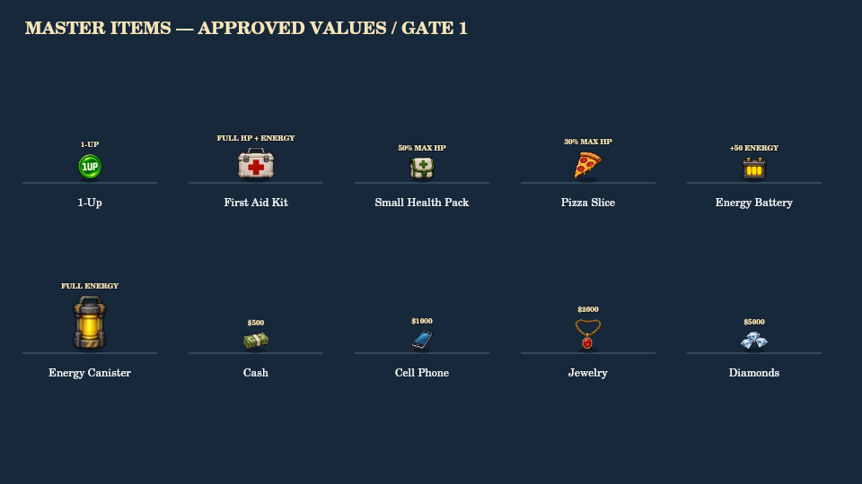
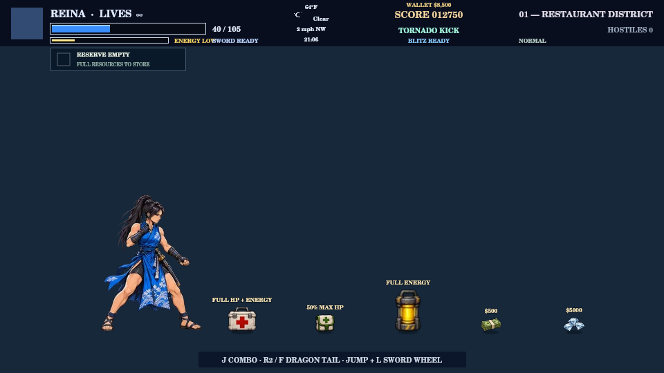

# Build 319 — Gate 1: audit and master items

## 1. Build and recovery checkpoint

Approved pre-change source: `195c4afdd91ca2f72e8d7e9cf31bcd176de1544b` (Build 318). Build 319 contains only Gate 1 plus the preserved master specification and geography-review requirement. The exact approved source reversals are recorded in `tools/items319/approved-source-lines.json`; no combat-code exclusions were added.

## 2. Implemented behavior

A shared, immutable twelve-entry registry now routes approved world pickups through the native collection loop. Cash ($500), collectible phone ($1,000), jewelry ($2,000), and diamonds ($5,000) add only to the new wallet; the HUD shows wallet and combat score separately. Stable pickup receipts prevent duplicate rewards when the same identity is restored or encountered again.

First Aid Kit restores full HP and full energy. Small Health Pack restores 50% max HP; pizza restores 30%; battery restores 50 energy; canister restores full current energy capacity. Resource gains clamp to the current maximum. Full-resource recovery items remain available rather than being wasted. 1-Up adds one native life. Nightshade's 3/6-round clips continue through her existing ammunition owner, capacity and budgets, and cannot be consumed by other heroes.

Existing legacy energy-cell placements become the approved battery without changing placements, chance, count, or random rolls. Existing valuables retain their native drop occurrence but receive the approved fixed wallet values. No additional random diamond or small-health-pack drops were introduced: these new registry entries support explicit scripted placement via the shared create API.

Native combat score remains separate. Existing hit/defeat points are retained, with supplementary danger-class defeat bonuses: regular 0, advanced 150, heavy 500, miniboss 1,000, boss 3,000. Classification comes from actual registered identity/Director/heavy metadata. These initial score-only settings do not change damage, AI aggression, attack timing, or enemy health.

## 3. Files changed

- `dist/items319.js`: registry, native collection delegation, wallet/receipt state, score metadata bonuses, validated economy snapshot API, audit data, Gunner health-pack eligibility.
- `dist/core.js`: approved pickups enter the shared registry from the existing overlap loop.
- `dist/energy316.js`, `dist/energy-ui316.js`: approved battery values and capacity-based canister amount/editor units.
- `dist/item319-data.js`, `dist/item-view319.js`, `dist/assets/items319/pickups.webp`: original grounded pickup artwork and rendering.
- `dist/game.js`, `dist/index.html`: wallet HUD, item renderer and Build 319 load/cache identifiers.
- `tests/items319.cjs`, `tests/items319-loot.cjs`, `tools/items319/`: runtime checks, exact baseline loot comparison, rendering and source receipts.
- `qa/system242/suites.json`, `tests/contact302-view.cjs`, `tools/charge318/approved.cjs`: QA registration, current cache assertions and exact receipt composition.
- `AGENTS.md`, `specifications/master-city-systems-user-spec.md`: preserved gate scope and required geography preview before final Gate 11 artwork.

## 4–6. Tests executed and results

| Test | Result |
|---|---|
| Master registry/native collection/wallet/resources/score/ammo/persistence | PASS — 170 checks |
| Exact Build 318 native enemy/furniture loot, RNG and budget comparison | PASS — 12 checks across four fixed seeds |
| Original item atlas alpha/crops/anchors/symbols/budget | PASS — 47 checks |
| Native item gallery and actual runtime HUD | PASS — two rendered captures |
| Contact feedback/render/cache guard | PASS — 52 checks |
| Energy runtime | PASS — 244 checks |
| Seeded energy comparison (nine paired encounters) | PASS — 18 simulations |
| Energy developer UI/defaults/presets | PASS — 12 checks |
| Nightshade ammunition | PASS — 182 checks |
| Nightshade level ammunition placements | PASS — 61 checks |
| Nightshade firing/pickup economy | PASS — 51 scenarios |
| Practice controls/groups/frame stepping | PASS — 4,147 checks |
| Industrial District runtime | PASS — 23,643 checks |
| One-second charge integration | PASS — 128 checks |
| Controller240 keyboard/standard/raw Sony/DSX simulated inputs and routes | PASS |

No final targeted automated test failed. An initial canister fixture incorrectly assigned maximum capacity directly; the existing settings controller correctly restored it. The corrected test changes capacity through the real developer settings API and passes at 180 capacity for all seven heroes. See `regressions.json` for captured targeted suite output. This is targeted regression coverage, not a new full-game certification.

## 7. Untested requirements

The managed preview server started, but the browser could not navigate to its returned address (timeout). Browser interaction and physical-controller playtesting are not certified. Full campaign save/load, multi-hero missions, reserve inventory, smartphone, purchases, deliveries, city map and later gates were not implemented or tested in this gate.

## 8. Visual evidence

The native renderer verifies the larger red-cross first aid case, smaller green-cross health pack, distinct item silhouettes, opaque sole anchoring, and separate wallet/score labels. The neutral capture background is a test fixture, not new level artwork. Rendering inspection is not represented as a successful browser playtest.

## 9. Known limitations

The game currently exposes unlimited test lives (∞); 1-Up increments the underlying native counter without changing that approved testing mode. The economy has validated export/restore state and persists across normal run transitions/simulation state; there is no existing unified durable full-campaign save, and this gate does not pretend to add one. A fresh run starts with zero wallet and no claimed receipts. Loading economy state replaces it rather than adding credits. Approved resource defaults remain compatible with temporary developer overrides; canister values use percentage-of-capacity units.

No reserve slot exists yet, so collection is immediate. The collectible phone is a valuable, not the later smartphone interface. Existing ammunition art remains unchanged. New item shipping artwork and metadata total 17,827 bytes; no existing art was recompressed or replaced.

## 10. Next gate

Gate 2 — one-item reserve inventory. Stop here until the next gate is requested. Gate 11 must show the proposed geography for review before final map artwork is finalized.
