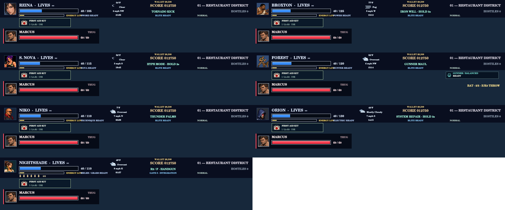
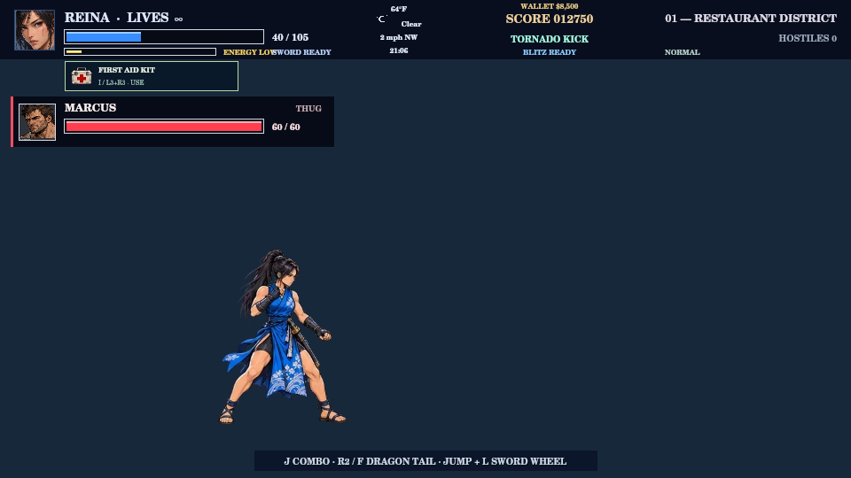
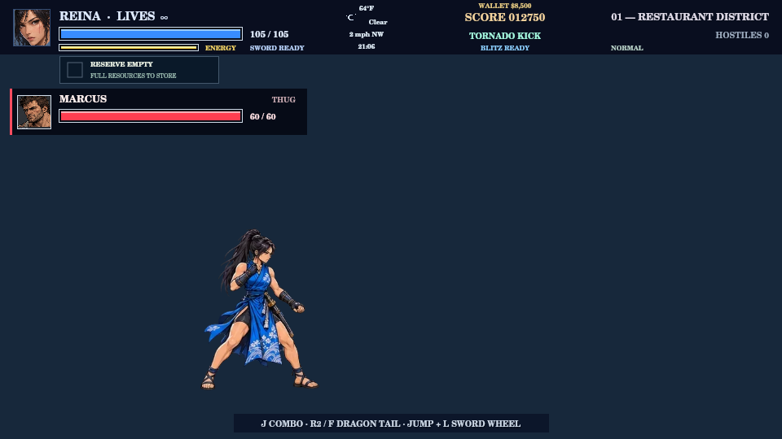

# Build 320 — Gate 2: one-item reserve inventory

## 1. Build and checkpoint

Build 320 implements Gate 2 only. Approved recovery checkpoint: `eafe74eed0529fd2c0b78bf7315c8268b3b7b0ec` (Build 319). Exact source receipts in `tools/reserve320/approved-source-lines.json` recover the preceding five edited production files; the original Gate 1 asset atlas is unchanged.

## 2. Features implemented

Each of the seven implemented heroes has one owner-associated reserve slot. Walking over a First Aid Kit, Small Health Pack, Pizza Slice, Energy Battery or Energy Canister stores it when the slot is empty. Storage does not change HP or energy. Explicit use applies the existing master item's effect through the existing Energy Controller and clamps to current resource maxima. An unusable full-resource item stays reserved.

When the slot is full, new items remain on the ground. The reserve panel offers use, exchange, or leave/close. Exchange stores the newly discovered item and returns the old one to its ground position; it does not destroy it. Claimed and consumption receipts prevent repeat collection/consumption of copied identities. Exchanges do not create random loot rolls or award score/currency.

Cash and valuables still go directly to the wallet, ammunition still applies directly through Nightshade's ammunition system, and 1-Ups still apply immediately. Weapon pickup/throw remains separate.

| Input | Action |
|---|---|
| I | Open reserve panel |
| Hold L3, then press R3 | Open reserve panel |
| Reserve Item toolbar button | Open reserve panel with pointer/touch |
| Arrows / D-pad / left stick | Select panel action |
| Enter or Space / × | Confirm |
| Escape or I / ○ | Close without exchanging |

R3 alone retains weapon pickup/throw; L3+Options retains developer tools. Combat mappings and Touchpad are unchanged.

Opening is rejected before pausing if the hero is attacking, charging/holding attack, grabbing, held, stunned, shocked, down, airborne, recovering or in a protected transition/story/ride/menu state. The native simulation loop and developer frame stepping cannot advance beneath the open modal. Held-button, menu-close and reconnect release gates prevent confirm/pickup/jump leakage. Closing restores the prior pause state.

Normal level progression retains inventory. Slots remain with their owners through the existing native hero-selection API; that API still resets its scene, and this gate does not introduce campaign switching. Explicit fresh reset clears all slots. Versioned economy snapshots include reserve state, validate owners and unique receipts atomically, and support old Gate 1 economy snapshots with empty inventory.

## 3. Files changed

- `dist/items319.js` (Reserve320 module appended): reserve state, eligibility, storage/use/exchange, owner retention, validated snapshots and actual audit data.
- `dist/item-view319.js` (ReserveUI320 module appended): paused accessible dialog, keyboard/controller/pointer interaction, atlas icons and HUD availability.
- `dist/core.js`: recovery pickups enter Reserve320 from the existing overlap loop.
- `dist/game.js`: pause/input integration, modal simulation guard and reserve HUD/toolbar mount.
- `dist/index.html`: new scripts, cache versions and Build 320 edition label.
- `tests/reserve320*.cjs`, `tools/reserve320/`: runtime, actual game input/loop tests, fixed-seed baseline comparison, native renders and exact source receipts.
- `tests/items319.cjs`, `tests/energy316.cjs`, `tests/nightshade256.cjs`: verify approved reserve-then-use behavior instead of the obsolete immediate recovery expectation.
- `tests/contact302-view.cjs`, `tools/items319/approved.cjs`, `qa/system242/suites.json`: current cache guard, exact receipt composition and new test registration.
- `AGENTS.md`: continuity and verification requirements.

## 4–6. Tests executed, passed and failed

| Test | Final result |
|---|---|
| Reserve runtime: all seven heroes/five recovery kinds, maxima, full slot, exchanges, prohibited states, ownership, snapshots and duplication | PASS — 505 checks |
| Actual game keyboard, native loop and simulated DualSense USB/Bluetooth/raw Sony/DSX controls | PASS — 51 checks |
| Exact Build 319 fixed-seed combat comparison without inventory operations | PASS — 1,353 frame/state/RNG checks |
| Master item/resource/wallet/ammunition integration | PASS — 170 checks |
| Original native loot signatures/RNG/drop budgets | PASS — 12 checks, four seeds |
| Energy runtime | PASS — 252 checks |
| Energy developer UI/defaults/presets | PASS — 12 checks |
| Nightshade ammunition | PASS — 183 checks |
| Nightshade level placements / firing economy | PASS — 61 checks / 51 scenarios |
| Practice controls, groups and frame stepping | PASS — 4,147 checks |
| Industrial District runtime | PASS — 23,643 checks |
| One-second charges | PASS — 128 checks |
| Contact feedback/render/cache guard | PASS — 52 checks |
| Controller240 / Hydro243 / Broxton244 | PASS — actual keyboard and simulated standard/raw Sony/DSX control paths |
| Controls260 / Playback265 / Diagnostics307 / Unique311 input | PASS — 12 / 14 / 16 / 32 checks |
| Native HUD render | PASS — all seven heroes, Forest/Gunner/weapon separation, before/after use |

The initial regression run retained in `regressions.json` had two failures: old ammunition and energy tests assumed immediate food/energy collection. Those expectations were updated to assert deferred storage followed by explicit native recovery; their other checks remain. The initial renderer fixture used an obsolete PNG path; it now resolves the game's current sprite metadata exactly as the real loader does. The fixed-seed comparison initially used real wall-clock Date in only one fixture; matching the existing fixed runtime clock removed that fixture discrepancy. These were test setup/approved behavior corrections, not damage or AI changes.

Final targeted rechecks and simulated input results are in `final-rechecks.json` and `input-regressions.json`. No final targeted automated test failed. This is scoped verification, not a new full-game release certification.

## 7. Untested requirements

Managed browser navigation to the preview server's exact returned address timed out; real browser modal layout/interaction remains unverified. No physical DualSense test or human play-feel approval is claimed. The new dialog's actual DOM controls and input paths are exercised by the simulation harness; native canvas renders verify HUD layout, not browser CSS layout.

No smartphone, delivery service, purchases, Astro-Call switching, home-base UI or later gate was implemented.

## 8. Visual verification evidence

The reserve card is separate from HP, energy, lives, weather, wallet, score and the enemy target card. Forest's card moves beneath the existing Gunner/weapon readouts. These are native renderer captures on a neutral test background, not browser screenshots or new level artwork. No artwork pixels or game assets were removed. Packaging bundles the new modules into the existing item script files. The unreferenced 881-byte grip-transitions124 authoring note was moved byte-for-byte to source-archive/build320; it is not used by any runtime page.

## 9. Known limitations

There is still no unified durable full-campaign save system. Inventory persists in the active run and validated economy exports; this gate does not claim automatic cross-session campaign saving. The owner-associated slots are prepared for the later switching system, while current hero selection retains its existing scene-reset behavior.

The reserve panel freezes combat while open but cannot be opened to escape an unresolved action. Items do not play a new healing animation; their original resource effect and feedback are reused. There is one nearby exchange candidate at a time, chosen by actual pickup distance. A fresh run or explicit scene restart clears inventory. Existing unlimited test lives remain unchanged.

A first publication attempt was rejected because TAR metadata/padding put the expanded package just over the 256 MiB hosting limit. The two new modules were bundled into the existing item scripts to remove file-header overhead; their separate readable authoring sources were preserved. The unused authoring note was also preserved outside the shipping package. The official packager uses standard 512-byte TAR records to avoid excess record padding. No feature or artwork was removed.

The verified expanded archive is 268,434,944 bytes, 512 bytes under the hosting limit. Later gates need an asset/package budget before adding new shipping files.

## 10. Next gate

Gate 3 — Prime City smartphone interface. Stop here until requested. Show the proposed geography for review before final Gate 11 map artwork.
