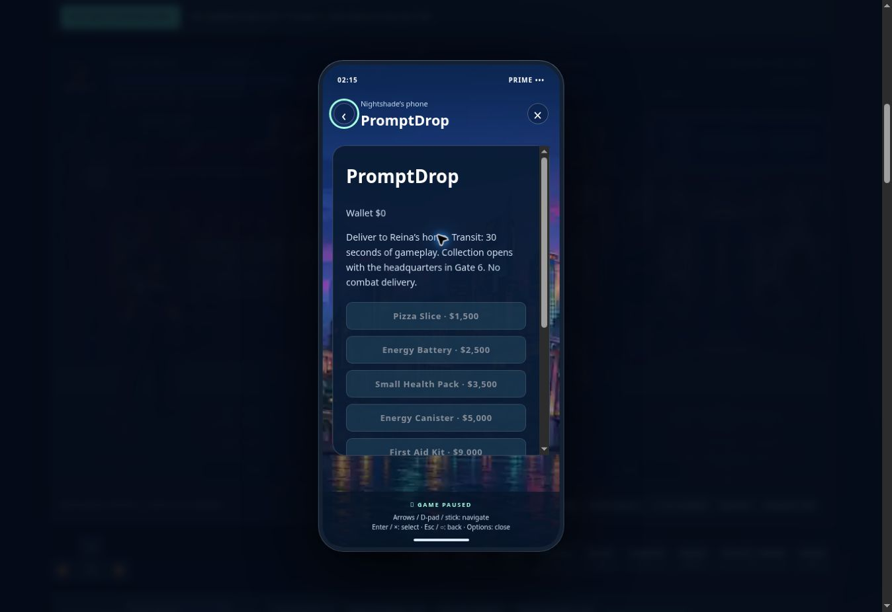

# Build 325 — Master City Systems Gate 4: PromptDrop

## Checkpoint and scope

Predecessor: `9676a3ad95b7a000d326fd8d54a5bf91a38f87b1` (published Build324). Recoverable tag: `checkpoint-before-promptdrop325`.

Gate4 implements ordering, wallet accounting, home delivery queue, history, validated snapshots and local supplies persistence. Gate5 Astro-Call is next. The actual headquarters/collection point belongs to Gate6 and is **not implemented or claimed in this gate**. No relationships, city geography or later services were added. Gate11 still requires the user's geography review before final artwork.

## Implemented

- Six explicitly registered products: Pizza $1,500; Battery $2,500; Small Health Pack $3,500; Canister $5,000; First Aid Kit $9,000; 1-Up $15,000. All prices remain provisional.
- Select a product, review the exact price, confirm or cancel. Purchase rechecks wallet, current price, product eligibility, available stock and home queue capacity.
- Unique receipts and idempotent confirmation: replaying an accepted order cannot deduct money or queue a second item. Changed quotes must be reviewed again.
- Atomic supplies journal: validated wallet+reserve+order state is written before the in-memory transaction commits. A storage failure leaves the wallet/order queue unchanged.
- Delivery uses 30 seconds of actual gameplay simulation. Pause/phone/practice/transition states cannot advance the campaign queue. Arrival is saved before the status becomes ready.
- Orders remain stored at Reina's home destination. Nothing spawns in combat and no HP, energy, score or life is granted by ordering.
- 32 uncollected delivery slots; maximum256 retained receipts. These are provisional bounded storage limits. Stock can be configured per product; initial catalog stock is unlimited, including First Aid Kits and 1-Ups. Zero stock and limited stock are validated and tested.
- Delivery history shows item, paid price, receipt ID and transit/ready status. Paid receipts are unaffected by subsequent price changes.
- Supplies checkpoint saves wallet, reserve and orders to this browser. After a reload, start a game and use Pause > Smartphone > PromptDrop > Review saved supplies checkpoint > Restore saved supplies. Restoration is explicit and replaces state, never adds credits/items.
- The supplies checkpoint **does not save/restore level progress, story flags, hero HP or combat score**. A fresh runtime run clears the runtime economy/queue as before; the saved supplies checkpoint stays available for explicit restoration. No unified full-campaign save is claimed.
- Existing Developer Panel: select `PromptDrop · [product] · price` in Temporary damage/recovery/PromptDrop prices. Six integer-only price fields use native safe-boundary edits, baseline/current/difference display, Undo, Redo, individual reset, confirmed group reset and proposed-change export. Reload restores baseline prices. No production balance file is edited by the UI.
- Phone keyboard/controller navigation now supports actionable service controls while retaining existing input containment and pause behavior.

## Files changed

Shipping: `dist/items319.js`, `dist/phone323.js`, `dist/experiments307.js`, `dist/diagnostics-ui307.js`, `dist/index.html`.

Readable new modules: `source-archive/build325/promptdrop325.js`, `promptdrop-ui325.js`. Repeatable compact bundler: `tools/promptdrop325/pack.py`. Public APIs and strings are preserved while private bindings are shortened. Original source checkpoint and exact five-file reversal receipts preserve rollback. Old unconnected PromptDrop placeholder prose is removed from shipping code. No art changed. One unused empty asset directory was removed; no asset file was removed.

New suites: `tests/promptdrop325.cjs`, `tests/promptdrop325-ui.cjs`, registered in `qa/system242/suites.json`. Exact325 source reversal composes before324/323 and older proofs.

## Verification

| Check | Result |
|---|---|
| PromptDrop native runtime |152 assertions passed |
| PromptDrop UI and existing input isolation |118 assertions passed |
| Original smartphone controller/keyboard/loop isolation |99 assertions passed |
| Master items |170 assertions passed |
| Reserve runtime |505 assertions passed |
| Automatic pickup rules |1,790 assertions passed |
| Combat diagnostics / safe experiments |79 assertions passed |
| Developer UI |22 assertions passed |
| Developer input |16 assertions passed |
| Exact predecessor source reversal |5 shipping files restored byte-for-byte |

Additional unchanged-system runs are retained in the execution results. No failing assertion was waived. Early test/packing adapter defects were corrected and the affected suites rerun.

## Rendered evidence and browser limits

Live managed browser: started Nightshade, paused, opened Smartphone > PromptDrop, verified all six catalog entries/prices, disabled unaffordable products, home-only destination, history and successful supplies-checkpoint message. Developer Panel exposed PromptDrop pizza with approved/current $1,500 and integer range. Rendered controls were inspected. Browser automation could not reliably fill the number field; live price editing is therefore **not browser-certified**. Native runtime/UI tests verify price edits, queued application, Undo/Redo and Reset.

The live catalog had a $0 wallet. Paid transactions, cancellation, duplicate confirmation, stock exhaustion, quota failure, arrival, restored purchases and controller containment were verified through the actual production runtime and simulated DOM tests, not represented as funded live-browser purchases. No physical DualSense, mobile viewport, full campaign, full release or human economic-balance certification.

## Known limitations / next gate

The player can order now, but cannot collect purchased items until the authored headquarters collection adapter is built in Gate6. The UI explicitly states collection is unavailable in this build. Delivery collection is not an untested completed feature; it is a deferred dependency.

Gate4 stops here after verification. Next: Gate5 Astro-Call hero replacement, followed by Gate6 headquarters under the user's separate continuation.
