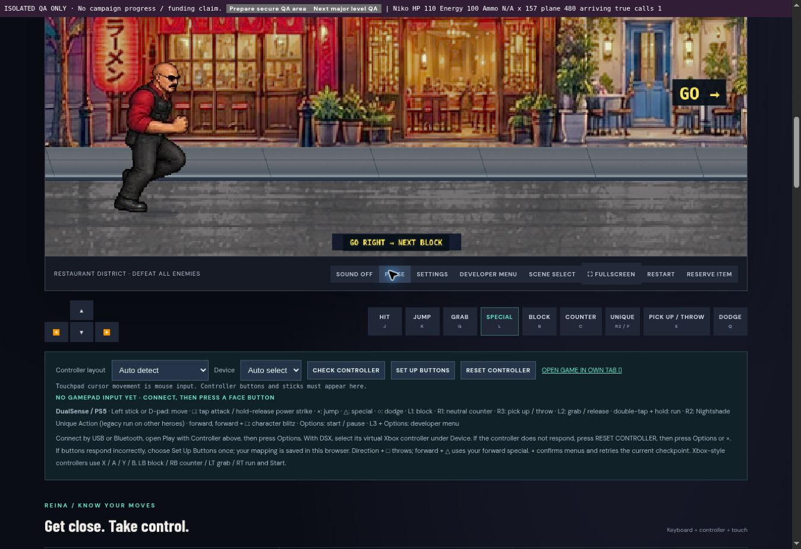
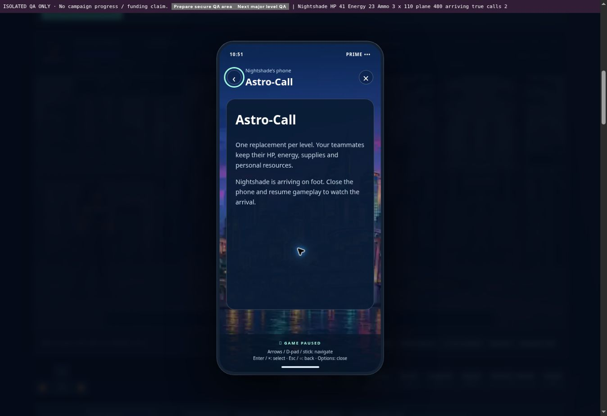
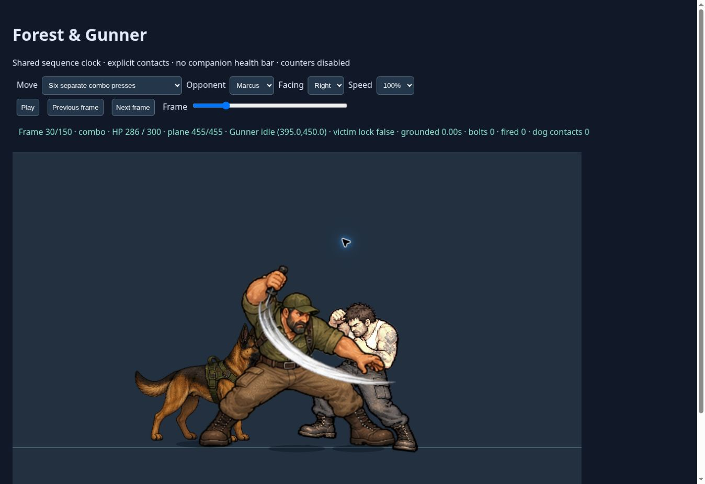

# Build326 — Gate5 Astro-Call

Implemented and verified 11 November 2026. Approved predecessor: `6b6a5d42c48e80bf59b7be1871845b76f5695865`; recoverable tag: `checkpoint-before-astro326`.

## Behavior

Pause → Smartphone → Astro-Call lists all seven registered heroes. Review an available ally, then confirm or cancel. Confirmation rechecks actual runtime eligibility. One successful replacement is allowed per major level, shared across that level's rooms and retries. Failed/cancelled requests do not consume it. No purchase cost was invented.

Calls require a fully cleared area, no pending entries/projectiles, no locked/boss fight, and a free grounded hero. Attacks, recovery, grabs, hitstun, charge, scripted transitions and unavailable/dead teammates prevent calls. Hospital calls are explicitly unavailable until its separate mission-switch adapter exists; calls cannot bypass hospital objectives.

Each deployed hero retains their actual actor object, HP, energy, reserve slot, status, weapons/durability, ammo, character resources and custom personal progression. Forest/Gunner world-owned state and Broxton's personal runtime state are restored separately. Orion's spent repair is retained. Incoming first deployment uses the fully initialized native hero factory; it does not consume campaign RNG or spawn with arrival invulnerability. Switching never resets the scene, enemies, score, lives, wallet or mission. Inactive personal countdowns/deadlines freeze; energy state is rebased to the same mission so changing rooms cannot grant a switch refill.

A nearby safe visible edge is selected using real combat bounds, obstacle footprints, path checks, holes, wires and industrial sludge. The incoming hero walks using native movement/animation to the outgoing position on the same combat plane. There is no end teleport. Threats, hurt states, obstruction or a watchdog stop the arrival at the actual position. Inputs remain contained until arrival and held-input release. The phone stays paused: close it, then resume to see the arrival.

Runtime audit exports include actual eligibility, roster facts and bounded call history. Phone menus use existing keyboard/controller containment. Browser inspection also revealed a pre-existing renamed-variable error on close when the original focus element remained connected. It now restores that real element; a regression exercises this branch.

## Files

- `dist/astro326.js`: roster, eligibility, safe route, native arrival and runtime report; readable mirror in `source-archive/build326`.
- `dist/phone323.js`: registered Astro-Call app, review/confirm/cancel, runtime history and focus repair. Readable added app source archived.
- `dist/game.js`: explicit fresh-run ownership hook. Ordinary retry preserves used allowance.
- `dist/energy316.js`: exposes the existing major-mission classifier.
- `dist/index.html`: script registration/cache versions/build label.
- Twelve legacy standalone inspector HTML pages plus two shared loaders: repeated parser-time include blocks factored without changing expanded HTML or script order. Exact original blocks and page receipts archived. No artwork changed.
- Three new registered tests and exact source-reversal receipts in `tools/astro326`; predecessor proof chain composes326 first.

## Verification

| Check | Result |
|---|---|
| Astro native runtime |244 assertions passed |
| Astro phone/native-loop/controller UI |119 assertions passed |
| Expanded legacy inspector pages/order |25 assertions passed |
| Original phone controls |99 assertions passed |
| PromptDrop runtime / UI |152 /118 assertions passed |
| Master items / reserve / automatic pickups |170 /505 /1,790 assertions passed |
| Reserve UI |51 assertions passed |
| Combat diagnostics / input |79 /16 assertions passed |
| Diagnostics UI |22 assertions passed |
| Industrial324 regression |220 assertions passed |

The runtime tests cover all seven heroes, real object reuse, exact resource retention, native factory RNG isolation, one-call scope, failed/cancelled calls, unsafe states/routes, retries, status deadlines, Forest/Gunner, Broxton armor and Orion repair. No failing assertion was waived. The phone-focus repair was retested in the browser and the affected UI regressions rerun.

## Rendered evidence

The managed browser used an explicitly labelled, temporary **isolated QA fixture**, setting a secure starting area rather than claiming a normal campaign playthrough. It was removed from shipping output after inspection.

Niko visibly walked from the edge to x480 on plane480; runtime status changed from arriving=true to false. The phone then rejected a second same-level replacement. Nightshade's saved state was shown as HP41/110 and energy23/100. At a different major level she returned with exactly HP41, energy23 and ammo3, and completed the native arrival on plane480. The phone stayed paused until explicitly resumed.

The character sprite room and Forest/Gunner inspector were both opened and rendered successfully after include factoring. Forest's inspector reached its real frame30 status and displayed both participants and Gunner. Those pages' expansion is also byte-identical to the predecessor.

## Limits and next work

Roster persistence is **within the current run**. It is not a new durable campaign/team save, and the supplies-only PromptDrop journal is not repurposed as an HP checkpoint. A fresh explicit run resets call ownership. Active native passive regeneration can occur during actual elapsed arrival gameplay; the swap itself grants no healing or recharge. Hospital switching remains blocked pending its authored mission rules. Cleared-area policy is deliberately stricter than merely hiding live enemies offscreen.

No physical DualSense, full campaign, mobile layout, full frozen release suite or human artistic/balance certification was performed in this gate. Script factoring preserves all artwork. Shipping uses standard512-byte TAR records and must remain under268435456 expanded bytes; check the actual official package result before publication.

Gate5 stops here. Gate6 headquarters and delivery collection have not been implemented. No relationships. Gate11 proposed geography must still be shown for review before final map artwork.
