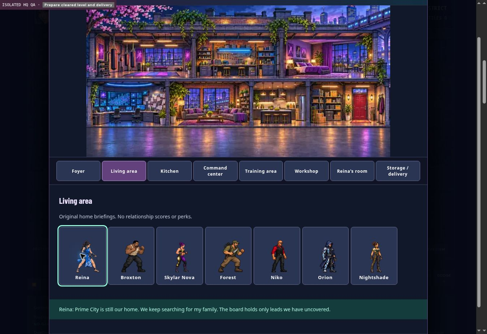
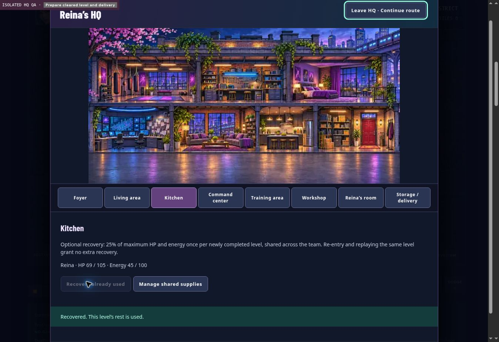
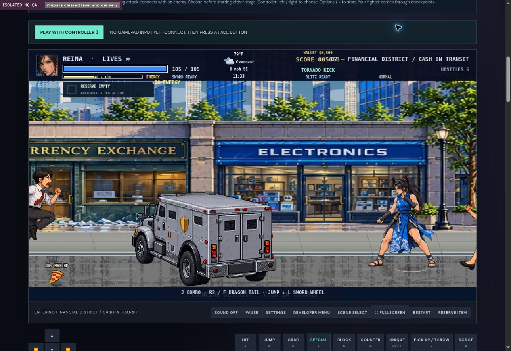

# Build327 — Gate6: Reina’s headquarters

Checkpoint: `checkpoint-before-home327`, approved predecessor `7b22f7bdf9f23368646fd407d061b5b935bb0699`. The interrupted local checkout was removed by workspace maintenance. This implementation was reconstructed from the approved source, recovered loft artwork and original specification; all results below are fresh verification, not reused claims from the lost checkout.

## Implemented

The home is an interactive room-based headquarters with original two-story loft artwork based on the supplied reference. Eight room selectors provide foyer, living area, kitchen, command center, training area, workshop, private bedroom, and storage/delivery functions. It is a furnished headquarters overview rather than a new walkable combat level.

Native level-completion events now offer **Continue route** or **Return to Reina’s HQ**. The existing campaign object, queued next destination, completion bonus and mission outcome remain intact while visiting. Gameplay, delivery clocks, attacks and developer frame stepping cannot run under HQ. Returning resumes the original completion/route selection flow. Ordinary area/block clears do not permit escapes to HQ. Authored final victories, including hospital outcomes, also receive the optional visit; unfinished TBD boss routes are not represented as completed levels.

The Storage / delivery room collects ready paid PromptDrop orders into a shared32-item store. Collection and inventory transfers use the existing atomic supplies journal. Save failure leaves the order and inventory unchanged. Claimed identities survive deposit/withdrawal; double collection and duplicate stored receipts are rejected. Existing carried reserve items can be deposited, and stored recovery items can be equipped into the active hero’s native reserve slot. One-Up deliveries become explicit, single-redemption life vouchers. Full storage leaves deliveries uncollected.

Optional rest restores25% of maximum HP and energy for the current hero, once per newly completed major level, shared across the team. Re-entering, replaying the same mission, reloading the journal or switching heroes cannot grant another use. Entering HQ itself grants no healing. Rest does not erase action/status fields; a post-level status cannot permanently prevent access to the optional visit. Native next-stage reset/resource policy is unchanged.

The living area displays all available heroes using existing character art and original authored briefings. Conversation receipts and availability are journaled. There are no relationships or stat perks. The command center shows actual completed missions, the queued route and registered discovered leads. The existing successful hospital witness outcome imports its confirmed transfer-alias/bank connection. Unfound evidence and future plot information are not invented.

Training selects any available registered hero/opponent and one of the existing0.1×–2× simulation speeds. It opens the production practice engine in a separate tab with unlimited enemy health. Campaign HP, energy, inventory, weapons and progress remain in the HQ tab. Existing practice frame controls remain available.

The workshop reviews deployed heroes’ actual HP, energy and reserve equipment. Crafting/permanent upgrades, cooking buffs, additional personal story scenes, free roaming and new campaign save architecture were not added.

## City map

`NeonCombat.CityLocations327.home` registers `reina-home` as **Reina’s HQ**, with a house landmark and an optional post-completion return connection. Both the smartphone City Map app and HQ command-center listing include it. No unreviewed street coordinates or district adjacency were invented. This gate provides the HQ location/connection record and visible listing; the full illustrated city map, touchpad shortcut and geographic placement remain Gate11, whose geography preview must be reviewed before artwork is finalized.

## Persistence

Home storage, delivery ledger, completed-mission records, discovered intelligence, hero availability, briefing receipts and spent-rest receipts participate in the existing supplies journal. Successful changes write before applying. Home-owned inventory/receipts and delivery history survive native resets. The earlier PromptDrop fresh-reset test was updated to the now-authorized persistent-home policy.

Browser restart uses the existing explicit **PromptDrop → Restore saved supplies** workflow; this restores the home journal as well. This is not a full campaign/world-position/hero-HP save. A redeemed life voucher’s receipt is saved, while actual campaign lives retain their existing runtime semantics. No automatic full-HP campaign restore was introduced.

## Files and storage budget

New production files: `dist/home327.js`, `home-ui327.js`, `home327.css`, `assets/home327.webp`. Integration changes: `game.js`, `index.html`, `phone323.js`, `audit-view135.js`, `astro326.js`. Readable new source, tests, source proof receipts, original recovered artwork and packaging tool are retained in the repository.

To remain within the hosting cap,21 JSON-only art/frame metadata assignments are encoded with a synchronous lossless dictionary decoder. Decoded numeric values, frame rectangles, anchors and source paths are identical; the decoder parses data and does not evaluate executable strings. Every original is archived, and exact source receipts reverse the changes to the predecessor. Existing artwork bytes are unchanged. Only the new HQ panorama is resized/compressed for shipping; its full-resolution original is retained in `source-art/home327/home-original.png`. The original generation used the user’s supplied home as architectural/mood reference: brick loft, warm windows, plants, neon blue/purple light, seven furnished room zones plus storage/foyer, no text or people. Current shipping derivative is600×300 WebP; it is an overview asset and is not suitable for close-up room zooms.

## Tests

See [verification.json](verification.json) for the actual per-suite results and output. Fresh verification includes all seven heroes, atomic save failure, collection/transfer uniqueness,32-item cap, persistent reset receipts, life-voucher deduplication, recovery caps, actual hospital intelligence, unavailable hero rules, practice exclusion, native Downtown route continuation, retained status fields, modal keyboard/controller input, native-loop isolation and all21 decoded data structures. Runtime tests:190 assertions. New UI tests:33 assertions in addition to119 retained phone/Astro tests. Data tests:21 files.

The broad scoped run covers25 suites, including Astro, PromptDrop, items/reserve/pickups, energy, diagnostics, practice, Industrial, controller input and legacy loader equivalence. No failed assertion was waived. An old custom-controller calibration fixture omitted the now-existing Unique Action and optional run steps; it was updated to include both, using a non-legacy run binding. `dist/gamepad.js` is byte-identical to the predecessor. This test does not certify arbitrary legacy-profile migration or physical hardware.

## Rendered verification

Managed-browser testing used an explicitly labelled isolated QA fixture to establish a completed level and a paid ready delivery. It was removed from shipping output. Verified: travel choice, home rendering, collection, reserve equip/deposit, displayed quarter recovery and disabled second rest, seven hero portraits, original briefing, map listing, separate production practice tab at0.25× with unlimited enemy health, return to the original route and actual travel into Financial District. No application errors were observed; extension metadata errors are not game errors.

The first route fixture started from an unrelated room; it was corrected to the actual Downtown completion zone before asserting route continuation. It was not treated as a production progression defect. Browser evidence is isolated scenario QA, not a full campaign playthrough.

## Limits and next gate

Physical DualSense, mobile layout, every mission ending, full frozen release suite and human art/balance approval remain unexecuted. The full city map is not complete in Gate6. Whole-world persistence/Living City integration and additional authored investigation feeds are Gate7 onward. No relationships. Stop after Gate6; next recommended gate is Gate7, Living City Director.
