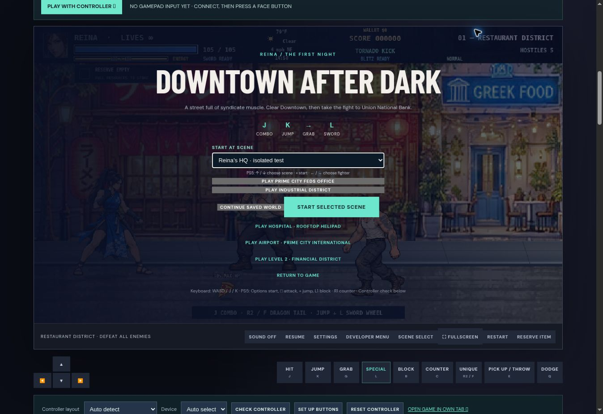

# Build328 — HQ in level select

User clarified that Reina’s HQ belongs in the level-select dropdown. The dropdown now has **Headquarters · Testing → Reina’s HQ · isolated test**. The initially proposed separate title button was removed.

Choose this option and confirm using the existing start button or controller. It works from the opening screen and the in-game Scene Select menu. HQ opens directly without completing a level. Exit returns to the title or the same paused level selector, as appropriate.

The test uses a separate native Brawler instance and an in-memory supplies journal. It includes a sample paid pizza delivery, reduced HP/energy, and the real HQ collection/storage/recovery/training controls. No completion bonus, campaign mission, original actor, wallet, reserve or saved supplies are altered. Factory creation restores the campaign RNG function. Active gameplay cannot invoke this test outside the level-select menu.

Checkpoint: checkpoint-before-hqtest328, predecessor e158e496efa8ac3095ea8b470a6b92c421ce0d0c. Files: dist/index.html, dist/game.js, dist/home-ui327.js; readable source archived. Exact source reversal composes before327. No art, combat balance or ordinary home-visit rules changed.

Validation: new UI test covers direct test initialization, sample collection/equip/recovery, exact campaign snapshot equality, RNG restoration, title dropdown, in-game dropdown, correct return labels, paused level-selector retention and rejection during ordinary gameplay. Existing190 HQ runtime assertions,33 HQ UI assertions plus119 phone/Astro assertions, native scene-controller regression and developer input source checks pass. Browser verified both dropdown entry paths, sample collection and return to the in-game selector. Physical controller hardware/full campaign/full release remain untested; existing native controller scene selection is retained.

