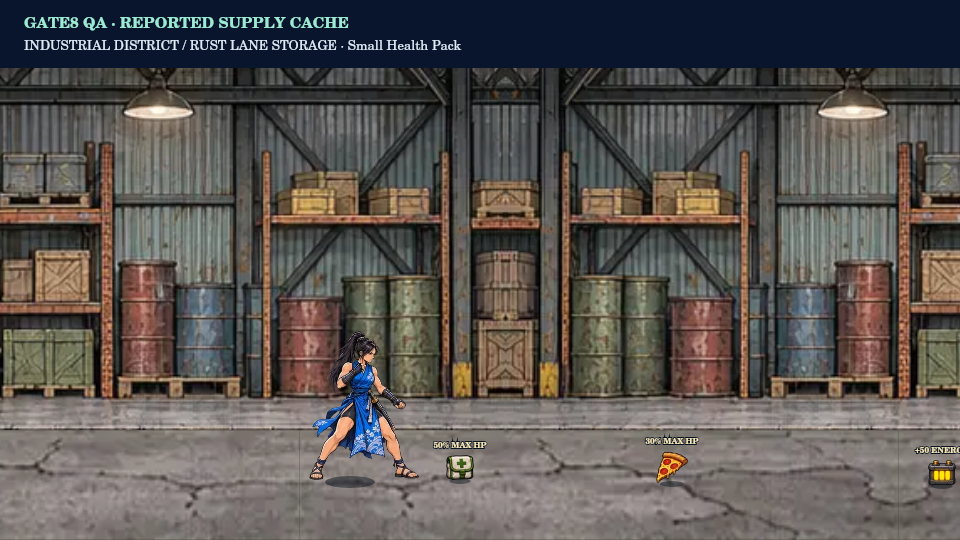
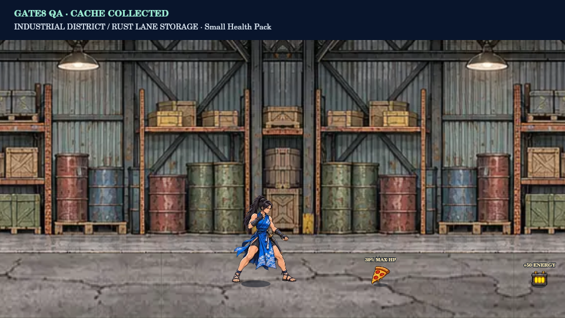

# Build335 — Gate8: Messages and item-cache discovery

## Completed behavior

The smartphone’s **Messages** app now displays private hero reports with a stable ID, registered hero sender, campaign-event timestamp, category, body, individual read status and linked source/district/cache IDs. Opening the inbox does not mark messages read. Opening one message marks only that message read; **Mark all read** is explicit. Keyboard and normalized controller actions use the existing paused-phone controls. Closing returns to pause.

Completed Living City assignments generate reports once. Investigation/reconnaissance in an already discovered Industrial District can reveal one of two authored caches in actual implemented rooms. Ordinary reports do not claim to have uncovered a new Syndicate lead. No major mission, secret route, relationship, enemy defeat or transportation incident is invented.

Supported message categories: hero updates, intelligence, side-mission offers, cache reports, emergencies, transportation alerts, story developments and personal conversations. The latter categories have a typed authored-message API; this gate does not manufacture nonexistent missions or emergencies to populate them.

## Actual cache locations

| Cache | Existing scene | Contents | Ground position |
|---|---|---|---|
| Rust Lane Storage · west aisle | `industrial-storage` | Small Health Pack:50% maximum HP | x760, y480 |
| Railyard Operations · office aisle | `industrial-rail-office` | Energy Battery:50 energy | x850, y480 |

Only reported caches appear in the **City Map** app’s destination listing. Messages link directly to that app. Undiscovered caches are hidden. The listing retains Reina’s HQ; it does not finalize illustrated geography, invent connections, teleport the hero or bypass story locks. Final map geography still awaits Gate11 review.

A discovered cache becomes an actual native pickup after its room is clear and safe. These locations have walkable aisles, no toxic puddles and native combat-plane anchors. Activation defers during encounters, transitions, player recovery and solid obstacles. Existing pickup artwork, item registry, needs-first consumption, one-slot reserve and native item handling remain authoritative. Normal enemy/destructible drop probabilities are unchanged.

Collection or reserve storage records the actual native claim, resolves the city marker and prevents further cache spawns. Re-entry, scene reset and normal save/load retain the receipt. Receipts use a campaign namespace so starting a new city campaign cannot collide with the previous campaign’s cache IDs. A generic city “resolve” script cannot falsely mark a physical cache collected.

## Before and after

| Build334 | Build335 |
|---|---|
| Messages placeholder | Functional inbox and individual message views |
| Offscreen activity only in HQ journal | Completed activities also produce private hero reports |
| Generic discovery-state capacity | Registered discovery event, message, destination marker and physical supplies |
| No inbox read-state persistence | Individual and explicit all-read states saved |
| No physical cache collection adapter | Native collection/storage receipts resolve reported markers |

## Files and architecture

- `dist/messages335.js`: typed inbox, assignment-event consumer, stable deduplication, authored cache registry, actual pickup activation/claims, validation and save integration.
- `dist/messages-ui335.js`: Messages and reported-cache Map adapters using the existing smartphone controls and pause behavior.
- `dist/city334.js`: notify Messages at city boundaries before saving the unified snapshot; protect physical cache resolution.
- `dist/index.html`: production loading and versioned cache refresh.

Both existing save paths carry the inbox and cache state: supplies/HQ journal and Continue Saved World’s environment snapshot. This extends those contracts; it does not add a full combat-position save. Legacy snapshots initialize an empty inbox. Corrupt or inconsistent receipts are rejected before restoring existing systems. Failed read-state saves retain unread status and expose a retry error. Inbox capacity is256 messages, with4096 processed source receipts; existing records are retained when full. Practice and isolated HQ testing cannot change campaign message read states or reveal its cache markers.

## Evidence

These are **native production canvas/simulation fixtures**, not browser screenshots or a full campaign recording.

[Runtime evidence](runtime-evidence.json) includes the actual source report, cache marker, spawned item, HP before/after, native claim and exact inbox restore result. The existing pizza and energy pickup visible in these images remain unchanged. Reina is rendered by the existing production sprite system; no animation or proportion change is claimed.

## Validation

[24 scoped suites](tests.json) pass, including:

- New Messages/cache tests: typed categories, deterministic replay, actual native contact collection, needs-first consumption, full-resource reserve storage, hidden markers, safe activation, stable IDs, conflicting ID rejection, capacities, read-state failure/retry, corrupt restore rejection, legacy migration, campaign namespaces and practice isolation.
- Actual production phone adapters in the existing DOM fixture: individual keyboard-open/read, explicit mark-all, controller selection of cache message, map link, hidden undiscovered location, retained HQ listing, close and paused-simulation behavior.
-4207 exact frame/state/RNG comparisons against Build334 for all seven heroes,600 simulation frames each.
- Living City, HQ, Astro, PromptDrop, item/loot/reserve, hospital, Industrial, airport, guard, counters, jumping, Nova and prior worker/Nightshade repairs.
- Native rendered cache-before/cache-after inspection with automatic native collection and exact inbox save/restore.

No damage, frame data, AI aggression, threat budget, control mapping, character artwork or existing route was changed. No tests were waived. The older reserve320-versus319 historical combat test remains outside this gate’s preservation comparison for the pre-existing reason documented in Build334; the direct Build334 comparison is the relevant baseline.

## Limits and next gate

Browser URL-policy restrictions still prevent live browser inspection. No alternate browser route was used. Native canvas and DOM checks do not certify browser layout, physical DualSense hardware or a complete campaign playthrough. The message and cache systems are reusable, but only these two authored cache locations are included initially.

**Stop after Gate8.** Gate9 adds the discreet unread-envelope HUD indicator and notification-sound settings. No HUD envelope, message tone, forced popup or public Pulse feed was added here. Gate11 still requires proposed-geography review before final map artwork.

Rollback checkpoint: `checkpoint-before-messages335`, Build334 commit `ffc8dc12f84c710a5530dad1750e5d27f53586af`.
