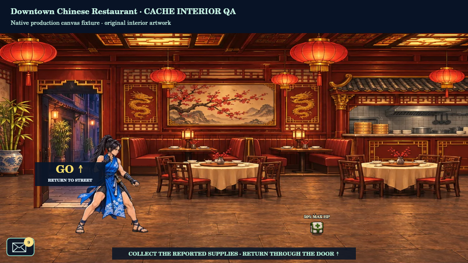
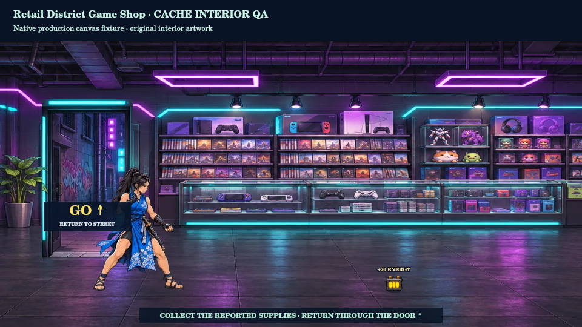

# Build336 — Worldwide visited-location caches and Gate9 notifications

## Completed changes

**Caches can now be reported across the game, provided the hero has visited the specific location.** The system records individual scenes/rooms and a safe ground position actually reached by the hero. It does not use a district visit to reveal all its unexplored rooms. Cached supplies defer until the room is clear, the hero is free, the position is onscreen, and the existing obstacle/hazard checks allow it.

Cache messages name the exact location. General locations include their actual room/section name and west/middle/east position. Store reports explicitly name the store and say the cache is inside. The City Map destination list exposes only reported locations. No new illustrated geography, roads or travel links were invented.

### Report spacing

- At least **three distinct scene/travel transitions** between cache discoveries.
- At most **one cache report per level/district visit**.
- Repeated two-room crossings do not meet the three-destination requirement.
- Script-only events, opening menus, waiting and reloads do not count as scene travel.
- The spacing state persists in both existing save paths.

This limit applies to cache discoveries. Ordinary hero updates remain a separate message category. Previously reported Build335 caches remain in the journal; new discoveries obey visited-location and spacing rules.

## Cache-enabled storefronts

| Store | Existing exterior | New interior | GO behavior |
|---|---|---|---|
| **Downtown Chinese Restaurant** | Restaurant District, existing Chinese restaurant frontage | Dining room, lanterns, wood panels, tables and kitchen counter | Appears only for a reported, uncollected cache after the exterior is clear |
| **Retail District Game Shop** | Retail District, existing Game Shop frontage | Game shelves, merchandise counter and neon shop lighting | Same conditional cache GO |

Each interior has original artwork, an unobstructed walking lane, a native collectible and a return doorway. Use Up near the storefront GO to enter, collect the supplies, then use Up at the interior doorway to return to the same exterior. The exterior GO disappears after collection. Entering does not reset the hero, heal them, refill energy, grant a completion bonus or replace the queued campaign route. Cache rooms are exploration/collection spaces, with combat commands disabled; no new enemy encounter was invented inside them.

Existing visited interiors elsewhere in the game are also eligible for general cache discoveries; this update adds **two new cache-only storefront interiors**, not an interior for every storefront in the city.

## Gate9 — Message notifications

- A small, passive envelope with unread count appears at the bottom-left of gameplay while private messages remain unread.
- No mouse/touch/key handler is attached to the indicator. It cannot directly open Messages or interrupt combat.
- Read messages through Pause → Smartphone → Messages.
- The icon disappears after all messages are read.
- New arrivals have one brief fade/pulse, then remain static. Reduced-distraction/reduced-motion presentation stays static.
- Optional original two-note UI chime; bursts are coalesced and audio channels do not overlap.
- Master SOUND OFF and UI Notification Volume are respected.
- No tone or pulse replays merely because a save with unread messages was loaded.
- Routine public Pulse records do not trigger the private inbox notification.

**Settings:** Message Notification Sound ON/OFF, Reduced Distraction ON/OFF, UI Notification Volume. Sound defaults ON. Reduced Distraction defaults it OFF unless the player explicitly chose otherwise. Preferences persist with the existing player settings; existing control/weather settings remain intact. Muting sound does not remove the envelope.

## Architecture and files

- `dist/messages335.js`: per-location visitation, safe visited coordinates, universal cache descriptors, report cadence, migration/validation and inbox-arrival hooks.
- `dist/cache-rooms336.js`: conditional storefront portals, two registered indoor locations, parent-scene preservation, walk/collect/return flow and brief scene fade.
- `dist/cache-rooms-view336.js`, `dist/assets/cache-interiors336.webp`: original interiors and matching correctly scaled doorways/GO feedback.
- `dist/notifications336.js`: transient, deduplicated arrivals; silent restore baseline; unread display and audio eligibility.
- `dist/notifications-ui336.js`: passive envelope drawing and nonoverlapping chime using the game’s existing audio context/master mute.
- `dist/environment217.js`: persistent notification/accessibility/volume settings in the existing Settings panel.
- `dist/game.js`, `dist/index.html`: production render/audio hooks and versioned loading.
- `dist/messages-ui335.js`: map destination labels for actual visited scenes and new interiors.

A registry sweep also exposed the pre-existing missing `Dialogue143.scene` API used by the prison security briefing. `dist/stabilize143.js` now schedules those authored lines through the existing dialogue queue, preserving their4+5+3-second sequence and12-second briefing duration. This removed the scene-start exception without changing combat.

## Evidence

These are inspected **production native-canvas fixtures**, not browser screenshots.

[Rendered/runtime evidence](render-evidence.json) records the exact hero cache messages, successful collection/return behavior and scheduled audio events. New artwork source and prompt: `art-source336/cache-interiors.png` and `art-source336/PROMPT.txt`; generated with built-in image generation. Shipping art is converted WebP, with no character artwork changes.

## Verification

[27 scoped suites](tests.json) pass, plus the native rendering/audio-schedule test (`render.log`). Coverage includes:

- Visitation, unvisited-store rejection, report spacing, repeated crossings, persistence and schema migration.
- Both storefronts: exact named report, conditional GO, actual Up-input entry/exit, walking, native pickup collection, no duplicate reward, parent restoration and post-collection GO removal.
- [211 existing scene starts across22 districts](location-coverage.json):208 eligible scene fixtures recorded visited locations. Three starts deferred under current script/readiness checks: Hotel/Brick, stadium elevator and Feds landing field. This is a registry/native fixture sweep, not211 full playthroughs.
- Envelope unread/read behavior, one-shot delivery, load suppression, master mute, UI volume, reduced distraction, explicit sound preference, persistent settings and new-campaign arrival reset.
- Existing keyboard/controller phone and Settings handlers.
-4207 exact frame/state/RNG comparisons against Build335 for all seven heroes,600 simulation frames each.
- Living City, HQ, Astro, PromptDrop, items, reserves, hospital, Industrial, airport, guards, counters, jump recovery, Nova and prior repairs.

No approved attack timing, damage, combat AI aggression, threat budgets or normal loot-drop probabilities were changed. Updated Gate8 fixtures now establish real visits and sufficient travel before expecting a cache report.

## Limits and next gate

The managed browser remains blocked by the prior URL-policy restriction. No alternate browser route was used. Native canvas, DOM and audio scheduling checks do not certify live-browser layout, physical controller hardware or speaker playback. Entry/exit and pickups were exercised natively; a full campaign traversal remains unexecuted.

Stop after Gate9. Gate10 is Prime City Pulse. Gate11 still requires proposed-geography review before final map artwork, including Reina’s HQ.

Checkpoint: `checkpoint-before-notifications336`, Build335 commit `bd5b5fc42da943d05d19301b99e5bcb65e9d88d6`.
